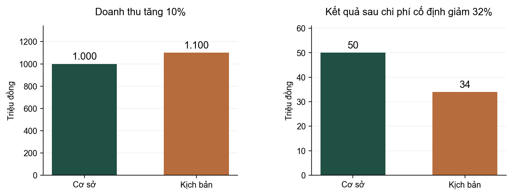

# Tài chính quản trị cho chuỗi siêu thị

Bản nghiên cứu bổ sung cho thiết kế dashboard hai vai trò. Tổng hợp ngày 02 tháng 11 năm 2026.

**Kết luận chính:** Cần giúp nhà quản trị chọn cách tăng lợi nhuận, bảo đảm tiền để vận hành và phân bổ vốn có hiệu quả. Mỗi chỉ tiêu phải dẫn tới một lựa chọn cụ thể, cho biết tác động dự kiến, điều kiện áp dụng và người chịu trách nhiệm.

Tài liệu kết hợp kiến thức từ ACCA, AICPA và CIMA, kinh nghiệm FP&A của AFP và báo cáo công khai của doanh nghiệp bán lẻ. Các câu hỏi, nhịp điều hành và thiết kế giao diện dưới đây là đề xuất cho dự án; chưa phải kết quả phỏng vấn lãnh đạo doanh nghiệp mục tiêu. [F01]

### Năm mối quan tâm cần liên kết

| Mối quan tâm | Câu hỏi quản trị |
| --- | --- |
| Tăng trưởng có chất lượng | Khách mua thêm hay chỉ tăng giá, giảm giá sâu hoặc mở thêm điểm bán? |
| Khả năng sinh lời | Sau giá vốn và chi phí phục vụ, phần còn lại tăng hay giảm? |
| Tiền và thanh khoản | Tuần nào có nguy cơ thiếu tiền cho nhà cung cấp, lương và khoản đến hạn? |
| Hiệu quả vốn | Vốn đang nằm ở tồn kho và tài sản nào; đầu tư mới có đáng thực hiện? |
| Khả năng thực thi | Ai thay đổi được kết quả; hành động có làm xấu dịch vụ hoặc tăng rủi ro? |

Dữ liệu hiện tại là mẫu giao dịch hộ gia đình Complete Journey. Chưa đủ cơ sở xác nhận doanh thu kế toán toàn chuỗi, lợi nhuận, dòng tiền, tồn kho hay hiệu quả vốn thực tế. Các ví dụ bằng VND trong tài liệu đều là giả định độc lập với dữ liệu này.

## 1 Ban điều hành cấp cao cần quyết định gì

Vai trò thứ nhất đại diện ban điều hành như CEO và CFO. Trang mặc định nên giúp đánh giá kết quả toàn chuỗi, triển vọng và các lựa chọn phân bổ nguồn lực; có thể đi sâu tới cửa hàng hoặc ngành hàng khi cần giải thích.

| Câu hỏi | Bằng chứng cần xem | Quyết định được hỗ trợ |
| --- | --- | --- |
| Tăng trưởng có bền vững? | Cửa hàng tương đương; lượt mua, giá bán, sản lượng và cơ cấu; tách cửa hàng mới. | Mở rộng, điều chỉnh giá hoặc xử lý mất khách. |
| Lợi nhuận hụt vì đâu? | Lãi gộp, số dư đảm phí, chi phí vận hành; cầu nối với kế hoạch và kỳ trước. | Giá mua, giá bán, cơ cấu hàng và ngân sách. |
| Có đủ tiền trong kỳ tới? | Tiền khả dụng, lịch thu chi, công nợ đến hạn và kịch bản thiếu hụt. | Tiến độ mua hàng, đầu tư và phương án tài trợ. |
| Vốn đang được dùng tốt? | Tồn kho bình quân, hiệu quả vốn, dự án đã duyệt và dòng tiền tăng thêm. | Ưu tiên cải tạo, mở cửa hàng hoặc giảm vốn bị giữ. |
| Điểm kinh doanh nào cần can thiệp? | Kết quả trực tiếp, khoản phân bổ, tuổi cửa hàng, khu vực và khả năng chuyển khách. | Sửa mô hình, thu hẹp, chuyển địa điểm hoặc đóng. |
| Triển vọng năm đã thay đổi thế nào? | Actual, kế hoạch gốc và forecast có phiên bản; giả định và khoảng bất định. | Chọn gói hành động và hạn mức rủi ro. |

**Bằng chứng từ thực tế:** Tesco công bố doanh số bên cạnh lợi nhuận hoạt động điều chỉnh, dòng tiền tự do, nợ ròng và hiệu quả vốn. Ahold Delhaize đặt doanh số, biên lợi nhuận hoạt động cơ sở, dòng tiền tự do và CapEx trong phần kết quả. Đây là ví dụ về cách kết nối tăng trưởng với lợi nhuận, tiền và vốn; không phải chuẩn mục tiêu áp dụng trực tiếp cho doanh nghiệp Việt Nam. [F10] [F11]

Trang cấp cao đề xuất ưu tiên các sai lệch trọng yếu và quyết định đang chờ. Ngưỡng trọng yếu theo số tiền, tỷ lệ và mức rủi ro cần được CFO và ban điều hành xác nhận; không tự đặt một ngưỡng chung cho mọi cửa hàng.

## 2 Người điều hành cần thay đổi điều gì

Vai trò thứ hai đại diện người điều hành hoạt động. Giữ một vai trò giao diện, đồng thời cho phép lọc theo phạm vi phụ trách như vùng, cửa hàng hoặc ngành hàng. Các thước đo phải gắn với quyền hạn và nguồn lực thực sự được giao.

| Tình huống cần xử lý | Chỉ tiêu và ràng buộc | Hành động có thể giao |
| --- | --- | --- |
| Hàng bán tốt nhưng thường hết | Sẵn có trên kệ, số ngày phủ hàng, thời gian giao; biên đóng góp. | Điều chuyển hoặc đặt bổ sung trong giới hạn vốn. |
| Hàng chậm và gần hết hạn | Tuổi tồn, hạn dùng, giá trị vốn bị giữ; hủy và giảm giá. | Dừng mua, điều chuyển hoặc giảm giá có ngưỡng. |
| Khuyến mại tạo doanh số nhưng tốn lãi | Số dư đảm phí tăng thêm, chi phí chiến dịch; tác động mặt hàng liên quan. | Thử nghiệm, sửa mức ưu đãi hoặc dừng. |
| Chi phí nhân sự lệch kế hoạch | Giờ công, chi phí, lưu lượng theo giờ; hàng chờ và chất lượng phục vụ. | Đổi lịch ca và năng lực phục vụ. |
| Cửa hàng hụt kết quả | Lượt mua, giỏ hàng, giá vốn, thất thoát; chi phí kiểm soát được. | Giao nguyên nhân cần kiểm chứng, người làm và hạn. |
| Nhà cung cấp giao kém | Đúng hạn, đủ hàng, giá mua thực nhận và điều khoản thanh toán. | Đổi lịch mua, thương lượng hoặc nguồn thay thế. |

**Đánh giá đúng trách nhiệm:** Tách hiệu quả cửa hàng khỏi thành tích người quản lý. Chi phí trực tiếp chưa chắc thuộc quyền quyết định của họ. Cần phân biệt chi phí kiểm soát được, chi phí trực tiếp ngoài quyền hạn và phân bổ trụ sở. [F04]

Một nhiệm vụ cần có phạm vi, nguyên nhân đang kiểm chứng, lựa chọn hành động, mức tiền hoặc dịch vụ bị ảnh hưởng, người phụ trách, hạn xử lý và kết quả đo lại. Mọi lợi ích dự kiến phải giữ nhãn ước tính cho đến khi xác nhận.

## 3 Doanh số tăng chưa đủ để kết luận tốt

**Ví dụ giả định trong cùng một tháng, đơn vị triệu đồng.** Giả định toàn bộ giá vốn là biến phí, phản ánh trong biên lãi gộp. Biến phí vận hành khác tách khỏi giá vốn và chỉ trừ một lần. Chi phí cố định trong phạm vi ví dụ giữ nguyên.

| Chỉ tiêu | Cơ sở | Kịch bản |
| --- | --- | --- |
| Doanh thu thuần | 1.000 | 1.100 |
| Biên lãi gộp | 25% | 22% |
| Lãi gộp | 250 | 242 |
| Biến phí vận hành khác bằng 8% doanh thu | 80 | 88 |
| Số dư đảm phí sau các biến phí nêu trên | 170 | 154 |
| Chi phí cố định trong phạm vi ví dụ | 120 | 120 |
| Kết quả còn lại sau chi phí cố định | 50 | 34 |

Doanh thu tăng 10% nhưng kết quả còn lại giảm 32%. Cần hỏi phần tăng đến từ giá, lượng hay cơ cấu và vì sao biên giảm. Con số cuối bảng chưa phải lợi nhuận ròng hoặc EBITDA đã đối soát. Đây là kịch bản số học, không phải ước lượng quan hệ nhân quả.

**Giảm giá cần bán thêm bao nhiêu?** Với một SKU giá 100.000 đồng và tổng biến phí 80.000 đồng mỗi đơn vị, giảm giá 5% làm đảm phí giảm từ 20.000 xuống 15.000 đồng. Phải bán thêm khoảng 33,3% số lượng để giữ tổng đảm phí. Ví dụ giả định không đổi biến phí đơn vị, chi phí cố định và năng lực phục vụ. Phân tích hòa vốn nhiều sản phẩm còn phụ thuộc cơ cấu bán. [F02]

## 4 Quyết định giữ hay đóng và bài toán tiền

### Khoản lỗ phân bổ chưa cho biết lợi ích của đóng cửa

Ví dụ giả định một tháng, triệu đồng. Nếu đóng cửa, toàn bộ số dư đảm phí mất đi, chỉ tiết kiệm được chi phí cố định tránh được; phân bổ trụ sở vẫn phải chi. Chưa xét chi phí đóng cửa, hợp đồng thuê, chuyển khách hoặc nguồn thu thay thế.

| Khoản mục | Giữ | Đóng |
| --- | --- | --- |
| Số dư đảm phí | 20 | 0 |
| Chi phí cố định thực sự tránh được khi đóng | 5 | 0 |
| Chi phí trụ sở vẫn tồn tại trong cả hai phương án | 25 | 25 |
| Kết quả trong phạm vi so sánh | −10 | −25 |

Cửa hàng đang lỗ 10 sau phân bổ, nhưng đóng theo các giả định này làm kết quả toàn doanh nghiệp giảm thêm 15. Phân tích quyết định cần xét dòng tiền tương lai thay đổi giữa phương án, khoản thực sự tránh được và chi phí cơ hội; tiền đã chi trong quá khứ không tự trở thành lợi ích của việc đóng cửa. [F03]

### Lợi nhuận và tiền có thể đi theo hai hướng

Mua thêm hàng để chuẩn bị mùa cao điểm có thể làm giảm tiền trước khi hàng được bán. Mua chịu làm tăng công nợ thay vì chi tiền ngay; bán chịu hoặc chậm nhận tiền thanh toán cũng tạo độ trễ. Vì vậy phải nối lợi nhuận với biến động tồn kho, phải thu, phải trả, khoản không dùng tiền và lịch chi khác. IAS 7 phân biệt dòng tiền hoạt động, đầu tư và tài trợ. [F09]

Chu kỳ chuyển đổi tiền bằng số ngày tồn kho cộng số ngày phải thu trừ số ngày phải trả. Cần kiểm tra lịch đối soát thẻ và ví, mùa vụ và điều khoản tín dụng; không xem chậm trả ngoài thỏa thuận là cải thiện mặc định. [F05]

**Ứng dụng đề xuất:** Xem kết quả kinh doanh theo tháng cùng dự báo thu chi theo tuần. Một cửa hàng có doanh số và lãi gộp tốt vẫn cần được kiểm tra nếu tiền bị giữ ở hàng chậm hoặc khoản đến hạn tăng nhanh.

## 5 Những định nghĩa phải chốt với tài chính

Bảng này là điểm khởi đầu cho từ điển chỉ tiêu. Mỗi định nghĩa cần bổ sung phạm vi, kỳ, đơn vị, thuế, chính sách điều chỉnh, nguồn và người xác nhận. Chưa có dữ liệu thì để chưa xác định, không thay bằng số không.

| Chỉ tiêu | Cách hiểu và điều kiện sử dụng |
| --- | --- |
| Doanh thu thuần | Theo chính sách kế toán đã đối soát; xử lý trả hàng, giảm trừ, thuế và khoản tài trợ đúng bản chất. Không tự đồng nhất với sales_value. |
| Lãi gộp và biên lãi gộp | Doanh thu thuần trừ giá vốn; biên bằng lãi gộp chia doanh thu thuần. Cần giá vốn hiệu lực đúng kỳ và cách xử lý rebate, freight, markdown, hủy. [F08] |
| Số dư đảm phí | Doanh thu trừ biến phí. Nếu bắt đầu từ lãi gộp thì chỉ trừ biến phí còn lại; nếu giá vốn chứa chi phí cố định phải tái phân loại để tính đúng đảm phí. [F02] |
| Kết quả theo cửa hàng | Trình bày rõ trước hay sau chi phí trực tiếp và phân bổ trụ sở; không đồng nhất với kết quả kiểm soát được của người quản lý. [F04] |
| Số ngày tồn kho | Tồn kho bình quân theo giá vốn chia giá vốn hàng bán trong kỳ, nhân số ngày của kỳ. Bình quân cần đủ tần suất để phản ánh mùa vụ. |
| Chu kỳ tiền | Số ngày tồn kho cộng số ngày phải thu trừ số ngày phải trả. Phải thu gắn doanh số bán chịu; phải trả gắn mua chịu. Dùng giá vốn thay mua chịu chỉ là xấp xỉ có nhãn. [F05] |
| GMROI | Lãi gộp trong kỳ chia tồn kho bình quân theo giá vốn. Ghi kỳ đo; không phải lợi nhuận ròng hoặc tiền được giải phóng. [F13] |
| ROCE | Lợi nhuận trước lãi vay và thuế chia vốn sử dụng bình quân theo chính sách. Cần thống nhất tài sản thuê và khoản loại trừ; ROIC hoặc ROI có thể có cách tính khác. [F04] [F12] |
| NPV dự án | Giá trị hiện tại dòng tiền tăng thêm với tỷ lệ chiết khấu phù hợp. Xét CapEx, thuế, vốn lưu động, ảnh hưởng cửa hàng khác và giá trị cuối kỳ. [F06] |

Doanh nghiệp cần tự xác nhận mẫu số và chính sách, thay vì sao chép tên KPI từ một chuỗi khác. Walmart công khai một cách tính ROI có các điều chỉnh riêng. Các chỉ tiêu điều chỉnh và dòng tiền tự do trong báo cáo công ty cũng cần đọc kèm định nghĩa. [F12] [F10]

## 6 Điều hành bằng kế hoạch và nguyên nhân

### Giữ riêng mục tiêu và kỳ vọng cập nhật

Kế hoạch gốc dùng để cam kết mục tiêu và phân bổ nguồn lực. Actual là kết quả đã ghi nhận, có trạng thái chốt hay tạm tính. Forecast là ước tính mới nhất dựa trên thông tin hiện có. Nên lưu phiên bản để thấy điều gì thay đổi; cập nhật forecast không tự xóa sai lệch với kế hoạch ban đầu.

Case thực hành FP&A của AFP mô tả việc kết nối tài chính và vận hành bằng trao đổi thường xuyên về tác nhân kinh doanh và dự báo liên tục. Đây là kinh nghiệm từ một trường hợp được ẩn danh; nhịp họp dưới đây là đề xuất cho dự án, không phải chuẩn bắt buộc cho mọi doanh nghiệp. [F07]

| Nhịp xem đề xuất | Trọng tâm | Đầu ra |
| --- | --- | --- |
| Hằng ngày | Thiếu hàng, hủy, lịch ca, giao hàng, lệch nguồn và sự cố. | Nhiệm vụ có người nhận và hạn xử lý. |
| Hằng tuần | Kết quả thương mại, tồn chậm, ưu đãi, dự báo thu chi và rủi ro. | Lựa chọn hành động trong hạn mức đã giao. |
| Hằng tháng | Đối soát và chốt sổ; cầu nối kết quả với kế hoạch; cập nhật forecast. | Điều chỉnh nguồn lực, giả định và mục tiêu hành động. |
| Hằng quý | Danh mục cửa hàng, đầu tư, nhà cung cấp, giá trị và rủi ro chiến lược. | Quyết định phân bổ vốn và đánh giá dự án đã thực hiện. |

### Từ sai lệch sang nguyên nhân có thể kiểm chứng

Với doanh thu, tách ảnh hưởng lượt mua và giá trị giỏ; khi có SKU và UOM chuẩn thì phân rã thêm giá, lượng, cơ cấu và cửa hàng mới. Với lãi gộp, kiểm tra giá mua, giá bán thực nhận, cơ cấu, khuyến mại, hủy và rebate. Các phân rã phải cộng lại được về đúng tổng và công bố cách xử lý tương tác.

Với chi phí, so thực tế với ngân sách điều chỉnh theo mức hoạt động phù hợp. Giữ riêng chi phí cố định trong phạm vi liên quan. Đánh giá trách nhiệm theo yếu tố người quản lý được quyết định. [F04]

Cảnh báo mẫu cần ghi rõ số tiền lệch, nguyên nhân nghi ngờ, bằng chứng còn thiếu, phương án, tác động dự kiến, ràng buộc và ngày đo lại. Màu đỏ nên biểu thị một tình huống cần xử lý theo chính sách đã duyệt, không chỉ là tỷ lệ giảm.

## 7 Dữ liệu cần bổ sung để kết luận đúng

Giao dịch trong mẫu hộ gia đình giúp mô tả hành vi mua quan sát được. Phạm vi này không cho phép suy rộng doanh thu hoặc năng suất toàn cửa hàng nếu chưa có thiết kế mẫu và dữ liệu bao phủ phù hợp. Cũng chưa đủ lịch sử để xác nhận tăng trưởng cửa hàng tương đương theo năm.

| Nguồn cần xin | Quyết định hoặc chỉ tiêu được mở |
| --- | --- |
| POS đầy đủ và master có lịch hiệu lực | Đối soát doanh số, trả hàng, giá thực nhận; lịch mở cửa, UOM, cửa hàng mới và tương đương. |
| Giá vốn và mua hàng | Lãi gộp thực tế; giá nhập, vận chuyển, rebate theo hợp đồng và chính sách phân bổ đúng kỳ. |
| Ảnh chụp tồn và luân chuyển | Tồn bình quân, tuổi hàng, hạn dùng, kiểm kê, thiếu hàng; vốn bị giữ và điều chuyển. |
| Sổ chi phí và trung tâm trách nhiệm | Kết quả cửa hàng, chi phí phục vụ và khoản kiểm soát được; phân biệt trực tiếp và phân bổ. |
| Nhân sự và ca làm | Chi phí lao động, giờ công, năng lực phục vụ và nhu cầu theo khung giờ. |
| Công nợ và ngân hàng | Lịch thanh toán, thực thu, đối soát thẻ và ví; dự báo thu chi, kỳ hạn và thanh khoản. |
| Kế hoạch và lịch sử forecast | Actual so kế hoạch; sai lệch, phiên bản giả định và nhu cầu điều chỉnh nguồn lực. |
| Tài sản và hồ sơ đầu tư | CapEx, hợp đồng thuê, vốn sử dụng, NPV dự án; đánh giá sau đầu tư. |
| Chiến dịch và nhật ký hành động | Chi phí, nhóm đối chứng và kết quả sau can thiệp; lợi ích thực sự tăng thêm. |

IAS 2 cung cấp tham chiếu về giá vốn tồn kho, chi phí mua và đo lường theo giá thấp hơn giữa giá gốc và giá trị thuần có thể thực hiện. Khi triển khai phải dùng chế độ, chuẩn mực và chính sách thực tế doanh nghiệp áp dụng; tài liệu này không kết luận doanh nghiệp mục tiêu bắt buộc áp dụng IFRS. [F08]

Mỗi bảng cần khóa và kỳ hiệu lực để nối đúng cửa hàng, SKU và thời gian. Cần số đối soát từ chủ nguồn; một file tự cộng đúng chưa chứng minh đã đủ hoặc khớp sổ. Không đưa dữ liệu giả định vào tổng actual.

## 8 Chuyển hiểu biết này thành dashboard

### Một trang tổng quan cho cấp cao

Đề xuất sáu nhóm nội dung: chất lượng tăng trưởng; lợi nhuận và cầu nối sai lệch; tiền khả dụng và thu chi tới hạn; vốn lưu động; đầu tư và danh mục cửa hàng; quyết định cần phê duyệt. Mặc định hiện các vấn đề trọng yếu, tác động ước tính và lựa chọn cần quyết định. Đi sâu theo phạm vi để kiểm chứng nguyên nhân.

### Một nơi tổ chức xử lý cho điều hành

Ưu tiên danh sách trường hợp cần làm theo mức tiền, dịch vụ và hạn xử lý. Mỗi trường hợp nối với cửa hàng hoặc ngành hàng, bằng chứng, hành động được giao, người nhận và kết quả. Giữ các ràng buộc về sẵn có hàng, thời gian chờ, tồn vốn, hủy và điều khoản nhà cung cấp để hạn chế tối ưu một chỉ tiêu gây hại nơi khác.

### Đặt dự báo vào đúng quyết định tài chính

Xác suất khách không mua lại không cho biết ưu đãi sẽ khiến khách quay lại bao nhiêu. Xếp ưu tiên chăm sóc cần thêm khả năng tác động, phần đảm phí tăng thêm kỳ vọng, chi phí, năng lực và kết quả thử nghiệm. Không nhân thẳng xác suất rủi ro với doanh số rồi gọi là doanh thu chắc chắn mất.

Dự báo bán chỉ hỗ trợ dự kiến hàng và nguồn lực khi đã có quy đổi đơn vị, tồn thực tế, lịch nhận hàng và lead time phù hợp. Không dùng dự báo USD trong mẫu hộ gia đình làm nhu cầu nhập hàng của toàn chuỗi. Mọi biên lợi nhuận và chi phí nhập tay phải mang nhãn giả định.

### Bảy câu hỏi cần xác nhận với doanh nghiệp

1. Ba quyết định tốn tiền nhất đang cần ra là gì? 2. Công ty định nghĩa lợi nhuận cửa hàng thế nào? 3. Ai được đổi giá, đặt hàng, tuyển ca và duyệt đầu tư? 4. Thiếu tiền thường xuất hiện vào thời điểm nào? 5. Kế hoạch và actual được chốt ở đâu? 6. Mất khách, hết hàng và hủy đang được đánh đổi ra sao? 7. Sau một hành động, ai xác nhận giá trị thu được?

**Tiêu chí nghiệm thu đề xuất:** Đại diện mỗi vai trò tìm được vấn đề, giải thích được số liệu, chọn được hành động trong quyền hạn và truy lại được kết quả. Các phần thiết kế trong tài liệu là đề xuất nghiên cứu; chưa phải thay đổi đã đưa lên website.

## 9 Nguồn và phạm vi tham khảo

Nguồn được đối chiếu cho phần nghiên cứu ngày 02 tháng 11 năm 2026. ACCA và IFRS cung cấp nền tảng chuyên môn; AFP cung cấp case thực hành; công bố của các chuỗi minh họa cách trình bày ưu tiên quản trị. Các ví dụ số học, ma trận quyết định và phương án dashboard do dự án xây dựng.

[F01] AICPA và CIMA cập nhật Global Management Accounting Principles năm 2023. https://www.aicpa-cima.com/news/article/aicpa-and-cima-update-global-management-accounting-principles

[F02] ACCA Cost volume profit analysis. https://www.accaglobal.com/gb/en/student/exam-support-resources/fundamentals-exams-study-resources/f5/technical-articles/CVP-analysis.html

[F03] ACCA Relevant costs. https://www.accaglobal.com/gb/en/student/exam-support-resources/fundamentals-exams-study-resources/f5/technical-articles/relevant-costs.html

[F04] ACCA Divisional performance management. https://www.accaglobal.com/ie/en/student/exam-support-resources/professional-exams-study-resources/p5/technical-articles/divisional-performance-management.html

[F05] ACCA Working capital management. https://www.accaglobal.com/gb/en/student/exam-support-resources/fundamentals-exams-study-resources/f9/technical-articles/wcm.html

[F06] ACCA Investment appraisal. https://www.accaglobal.com/uk/en/student/exam-support-resources/prodipsust-study-resources/technical-articles/investment-appraisal.html

[F07] AFP How We Tamed the Budget Monster năm 2023. https://www.financialprofessionals.org/training-resources/resources/articles/Details/how-we-tamed-the-budget-monster

[F08] IFRS Foundation IAS 2 Inventories. https://www.ifrs.org/issued-standards/list-of-standards/ias-2-inventories/

[F09] IFRS Foundation IAS 7 Statement of Cash Flows. https://www.ifrs.org/issued-standards/list-of-standards/ias-7-statement-of-cash-flows/

[F10] Tesco Preliminary Results 2025 26 công bố năm 2026. https://www.tescoplc.com/media/ch1fbgss/tesco-plc-preliminary-results-statement-fy26.pdf

[F11] Ahold Delhaize Annual Report 2025. https://aholddelhaize.com/digitalannualreport/2025/

[F12] Walmart trình bày kết quả năm tài chính 2026 và cách tính ROI. https://stock.walmart.com/sec-filings/all-sec-filings/content/0000104169-26-000032/earningspresentationfy26.htm

[F13] Infor Profitability ratios và công thức GMROI trong tài liệu nghiệp vụ. https://docs.infor.com/csdis/latest/en-us/useradminlib_csd_cloud/icolh/pez1503926107161.html

Tesco trình bày các APM kết quả 2025/26 trên cơ sở so sánh 52 tuần, còn nợ ròng tại ngày báo cáo. Không dùng trực tiếp số APM thay số kế toán hoặc trộn kỳ. Tỷ suất và thước đo trong báo cáo quốc tế không phải mức chuẩn cho bộ dữ liệu năm 2017 hoặc doanh nghiệp đang khảo sát. [F10]

Infor mô tả GMROI trong tài liệu nghiệp vụ quản trị hàng hóa; chi phí vận hành và vốn khác vẫn cần được xem thêm. Tài liệu công bố của nhà bán lẻ không thay thế việc phỏng vấn người quyết định trong doanh nghiệp mục tiêu. [F13]
